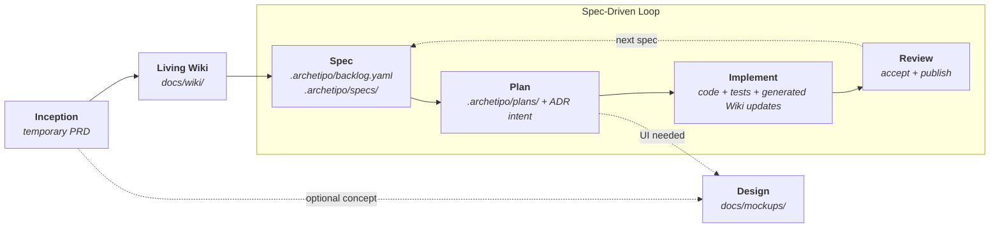

<div align="center">

# ARchetipo

**English** · [Italiano](README.it.md)

**Understand a product problem, build a working solution, learn from use, and adapt.**

ARchetipo is evolving into a shared product workspace for people and coding agents. Describe a problem in chat, work in a dedicated local environment, try the app, and keep the specification, observations and decisions with the work. A tested version can be handed to developers through a pull request. A useful investigation can also conclude without code.

[](#)
[](#license)
[](#)
[](#)

[Quickstart](#quickstart) · [Workflow](#workflow) · [Where to start](#where-to-start) · [CLI](#cli-and-commands) · [Configuration](#configuration) · [FAQ](#faq)

</div>

---

## Why ARchetipo

The product loop is **problem → working solution → observation → decision → adaptation**.
A specification captures behavior and assumptions as they evolve. Stories, estimates,
formal plans and a delivery backlog are not prerequisites of the new chat path.
The CLI keeps artifacts and Git operations deterministic; the agent owns judgment.

This branch implements the new core while the older workflow remains available.
The product-work contract and current limits are described in [Product work](docs/increments.md).
The delivery-oriented sections below document those retained workflows; they are
not mandatory steps of the new product path.

---

## Quickstart

### 1. Install the CLI once

```bash
npm install -g @techreloaded/archetipo
```

**Alternatively:** if you cannot install npm packages globally, install ARchetipo as a local project dependency.

```bash
npm install @techreloaded/archetipo
```

Then add the local CLI to your session `PATH`:

```bash
# Windows PowerShell
$env:PATH = "$(Get-Location)\node_modules\.bin;$env:PATH"

# macOS / Linux
export PATH="$PWD/node_modules/.bin/:$PATH"
```

After that, `archetipo init` works as usual.

### 2. Initialize a project

```bash
cd my-project
archetipo init

# or non-interactive:
archetipo init --tool claude --connector file

# picking the process Template explicitly:
archetipo init --tool claude --connector file --template fabbrica-del-software
```

`archetipo init` copies the skills of the selected **process Template** into the AI tool directory, for example `.claude/skills/`, `.cursor/skills/`, or `.gemini/skills/`, and creates:

- `.archetipo/config.yaml`, including a `template:` block with the `id` and `version` of the Template that shaped the workspace
- `.archetipo/shared-runtime.md`

The Template decides which skills the workspace receives and which workflow statuses its process uses. Omitting `--template` selects `fabbrica-del-software`, the process this README describes, so an initialization without an explicit choice behaves exactly as before. An unknown Template id is rejected before anything is written, so it never leaves a partial workspace behind.

After that, use the `/archetipo-*` skills inside your AI coding agent. The skills call the CLI in the background when they need to read or persist workflow artifacts.

### Using with Hermes

To use ARchetipo as the software-delivery tool inside [Hermes](https://github.com/nousresearch/hermes-agent), with one Hermes Project and Kanban board per repository, see [`integrations/hermes/`](integrations/hermes/README.md).

---

## Workflow

ARchetipo implements Wiki-backed Spec-Driven Development: living project knowledge guides each increment and is refreshed through `spec -> plan -> implement -> review`.

The living Wiki uses an [Open Knowledge Format (OKF)](https://github.com/GoogleCloudPlatform/knowledge-catalog/blob/main/okf/SPEC.md)-compliant Markdown structure.



| Step | Skill | Output | What happens |
|---|---|---|---|
| 1. Discovery | `/archetipo-inception` | `docs/wiki/` | Produces a temporary PRD, compiles it into living knowledge, and preserves it as a `references/` concept. |
| 2. Visual concept, optional | `/archetipo-design` | `docs/mockups/` | Creates isolated HTML/CSS mockups without touching application code. |
| 3. Backlog | `/archetipo-spec` | `.archetipo/backlog.yaml`, `.archetipo/specs/` | Loads relevant Wiki pages and creates or extends INVEST-compliant user stories. |
| 4. Planning | `/archetipo-plan US-001` | `.archetipo/plans/US-001-plan.yaml` | Produces the technical solution, ordered tasks, test strategy, and a `decisions/` ADR contract when the choice crosses the architectural threshold. |
| 5. Code | `/archetipo-implement US-001` | Code, tests, generated Wiki/ADR updates | Executes the plan, attaches repository evidence to decisions, validates capability coverage, and moves the spec toward human approval. |
| 6. Acceptance | `/archetipo-review US-001` | Verdict: `DONE` or rework feedback | Presents code and Wiki together, including ADR rationale, alternatives, consequences, and evidence, then executes the human verdict. |

### Workflow states

Specs move through standardized states. ARchetipo automates the loop; acceptance is human by default, or autonomous when you run Autopilot.

| State | Meaning | Transition |
|---|---|---|
| `TODO` | Spec exists in the backlog and has not been planned yet. | Created by spec |
| `PLANNED` | Technical planning is complete. | Set by plan |
| `IN PROGRESS` | Implementation has started. | Set by implement |
| `REVIEW` | Code review and tests are complete; ready for review. | Set by implement |
| `DONE` | Spec accepted and released. | Human approval via `/archetipo-review`, or autonomous acceptance via `/archetipo-autopilot` |

### The AI team

ARchetipo personas are not theater; they are lenses that make the process visible.

| Persona | Role | Main expertise |
|---|---|---|
| Andrea | Product Manager | Vision, personas, MVP scope |
| Costanza | Business Strategist | Discovery, positioning, product hypotheses |
| Emanuele | Requirements Analyst | Acceptance criteria, edge cases, spec quality |
| Leonardo | Architect | Technical solution and architectural decisions |
| Ugo | Full-Stack Developer | Implementation and task breakdown |
| Mina | Test Architect | Test strategy and coverage |
| Cesare | Code Reviewer | Quality, security, adherence to the plan |
| Livia | UX Designer | Mockups and visual language |

---

## Where to start

Use this decision guide inside your AI coding agent:

| Question | If the answer is no | If the answer is yes |
|---|---|---|
| Do you already have a PRD? | Run `/archetipo-inception`. | Continue. |
| Do you want visual concepts before development? | Skip design for now. | Run `/archetipo-design`. |
| Do you already have a backlog of specs? | Run `/archetipo-spec`. | Continue. |
| Are the specs already `PLANNED`? | Run `/archetipo-plan US-001` on a `TODO` spec. | Continue. |
| Is a spec ready for implementation? | Plan it first. | Run `/archetipo-implement US-001`. |
| Is a spec waiting in `REVIEW`? | Implement it first. | Run `/archetipo-review US-001` to accept it or send it back. |

For batch work, `/archetipo-autopilot` runs the complete pipeline — planning, implementation, and autonomous acceptance — until every eligible spec reaches `DONE`. Run it without arguments for the whole eligible backlog, or pass any combination of `EP-XXX` and `US-XXX` selectors — `/archetipo-autopilot EP-002 US-011 US-030` works on the union of what they select. Add `--max-specs N` to cap the run at `N` specs: the queue is truncated when it is frozen, so the specs left out are never touched and the closing report lists them.

Autonomous acceptance applies the same gate as `/archetipo-review`, verdict included: it approves only when every acceptance criterion is met, every task is done, and the Wiki has no blocker. When it is not, it sends the spec back with structured feedback for at most three rework cycles; a spec that is still not acceptable stays in `REVIEW` for you, and Autopilot moves on to the remaining unblocked specs.

---

## CLI and commands

The viewer offers Conversation, Board and **Documentation** as peer views. Documentation reads the configured `paths.wiki` even when automatic Wiki maintenance is off: browse by topic, search titles and content, follow Wiki links, and inspect review state and sources. Page URLs support reload and browser Back/Forward. Use **Crea Wiki** for an absent or empty Wiki, **Aggiorna Wiki** to refresh its contents, **Altre azioni → Verifica Wiki** to check and repair it, and **Chiedi su questa pagina** to discuss the selected page. These actions open dedicated native conversations, show progress and changed pages in Documentation, and keep approval separate. **Ricarica** only reloads the reader. Explicit Wiki actions remain available when automatic maintenance is off; they require a local provider with native sessions. Other document collections can be added independently.

ARchetipo uses a deterministic Go CLI, `archetipo`, for persistence and connector operations. In normal use you speak to the skills; the skills call these commands behind the scenes.

| Command | Purpose |
|---|---|
| `archetipo init [--template <id>]` | Installs the skills of the selected process Template into the current project and creates `.archetipo/config.yaml` — with the Template `id` and `version` — plus `.archetipo/shared-runtime.md`. |
| `archetipo doctor` | Diagnoses the installation: data directory, packaged and installed skills, project config, git, and gh auth (github connector). |
| `archetipo view` | Starts a local Kanban view for `.archetipo/backlog.yaml`, `.archetipo/specs/`, and `.archetipo/plans/`. Its Execution panel selects the workspace default provider from the registered ones — non-secret settings only — each spec shows the actions its process Template admits in the spec's current status, and a conversation with the agent is a durable native session of the harness. See [Conversations are native harness sessions](#conversations-are-native-harness-sessions). |
| `archetipo config show` | Initializes the connector and prints metadata, including the workspace process Template (`id` and `version`). |
| `archetipo prd write [--file PRD.md]` | Saves PRD markdown from `--file` or stdin. |
| `archetipo validate prd [--file PRD.md]` | Validates the PRD against structural PRD rules. |
| `archetipo spec list [--status STATUS]` | Reads backlog items and summary metadata, optionally filtered by status. |
| `archetipo spec add --file specs.yaml` | Creates or extends the backlog with specs (user-story body). |
| `archetipo spec show US-001` | Reads one spec and its tasks by code. |
| `archetipo spec next --status TODO` | Auto-selects the first eligible spec by status. |
| `archetipo spec actions US-001` | Lists the actions the workspace process Template admits for the spec's current status, each with a stable id, a user-facing label and the skill that realizes it. A status with no admissible action returns an empty list. |
| `archetipo spec plan US-001 --file plan.yaml` | Saves the implementation plan and moves the spec to `PLANNED`. |
| `archetipo spec start US-001` | Moves a planned spec to `IN PROGRESS`. |
| `archetipo spec review US-001 [--file note.md] [--commit-type feat] [--commit-summary "summary"]` | Moves a spec to `REVIEW`, posts a closing comment, and auto-commits dirty changes — always in the spec worktree, and in the project root when `git.auto_commit` is on — with a Conventional Commit subject (default: `chore(US-001): {title}`). |
| `archetipo spec request-changes US-001 --file feedback.json` | Sends a spec in `REVIEW` back to `TODO` with structured rework feedback appended to its body. |
| `archetipo spec update US-001 --file patch.yaml` | Applies a partial patch (title, priority, points, scope, blocked_by, body, epic, rework) to an existing spec. All connectors supported. |
| `archetipo spec integrate US-001` | Merges a reviewed spec's worktree branch into base, cleans up, and marks it `DONE` (worktree workflow). |
| `archetipo task done US-001 TASK-01` | Marks one task as completed. |
| `archetipo execution setup [--url <hub>] [--workspace <name>]` | Configures the default execution provider: verifies the credential against the hub, picks the workspace (without asking when there is only one), and writes `execution.default_provider`. |
| `archetipo execution provider list` | Lists the registered providers, their capabilities, the configuration keys each accepts, and whether it can dispatch right now. |
| `archetipo execution provider set-default <id> --file provider.yaml` | Validates and atomically saves the workspace default provider and its non-secret configuration. |
| `archetipo execution provider show-default` | Reads the configured default provider without exposing environment credentials. |
| `archetipo execution run US-001 plan [--provider <id>]` | Creates one durable execution and dispatches `plan`; an explicit provider overrides the workspace default. |
| `archetipo execution show <execution-id>` | Reads the persisted success result or provider error for an execution. |
| `archetipo metrics` | Reports backlog progress: totals, completion, per-epic breakdown, WIP, rework, blocked specs, and average cycle/lead time from the recorded status history. |
| `archetipo spec move US-001 --to review` | Reorders or moves a spec across workflow columns. |
| `archetipo validate spec --file specs.yaml` | Validates a generated spec payload without persisting it. |
| `archetipo validate plan US-001 --file plan.yaml` | Validates a generated plan payload without changing the spec status. |

The CLI reads `.archetipo/config.yaml` from the project to choose the active connector and artifact paths. All `archetipo validate ...` commands return `kind: "validation_result"` on stdout with `data.ok` set to `true` or `false`; error envelopes are reserved for process failures.

Execution records are local runtime state under `.archetipo/executions/` and are ignored by Git. The optional `execution.default_provider` section stores a registered provider ID and non-secret configuration; tokens and credentials must remain outside `.archetipo/config.yaml`. `set-default` validates before an atomic update, while a run without `--provider` validates the saved configuration again before dispatch. An explicit `--provider` always wins and receives an empty configuration. Three providers ship registered — `arcipelago`, `codex` and `claude`; `archetipo execution provider list` shows what each accepts. Both successful dispatches and recorded provider failures return a `kind: "execution"` envelope; provider lookup, configuration, and capability failures return an error envelope before any record is created.

### Conversations are native harness sessions

A conversation in `archetipo view` is not a chat wrapped around a one-shot invocation: it is a **durable session of the coding harness itself** — Claude Code or Codex CLI — running on your machine, in your project directory, with your tools and the skills your runtime actually has.

Claude and Codex support the same six workflow actions: inception, backlog generation, story draft, planning, implementation and review. Their local batch executions share receipt acceptance, question/answer handling, result projection and bounded shutdown. In the viewer, each action runs in a durable native session and its receipt closes only the action. Story drafting also works before a PRD or populated backlog exists: the agent can propose a new epic name, and the story and epic are persisted only after confirmation.

Story discovery brings in the inception personalities: Andrea, Costanza, Livia, Leonardo and Emanuele challenge value, assumptions, user experience, feasibility and acceptance criteria, with one question at a time. One `/archetipo-spec` invocation can produce several stories when the agreed scope benefits from a split. In the viewer, compact references stay at the point where each version was proposed; a separate panel shows the formatted stories, earlier versions and changes to approve. Accept each story into the backlog, edit it in the form, or continue refining it in the same chat. Revisions update the existing story code and preserve its workflow state and plan. Older renamed proposals without a stable identity ask you to select the target story. Acceptance survives reloads and retries, including when you changed the proposed title.

Native controls remain explicit capabilities of each harness. Codex exposes structured input requests: the viewer renders their choices, free answers and masked secret fields as ordinary form controls, and the adapter encodes the response for its runtime. Claude's stream-json protocol supports questions as ordinary messages and does not advertise structured input; workflow actions require neither a structured-input capability nor a particular question format. Models and permission settings remain those of the selected runtime.

What that means in practice:

- **It does not expire.** No global timeout and no inactivity timeout ever close a conversation. Closing the browser tab does not interrupt the work; interrupting a turn stops that turn and nothing else. A conversation is closed when you close it.
- **It comes back.** Restart `archetipo view` and the conversation is still there, with the same id and the same native session: the agent remembers what it did, because the context belongs to the harness and is resumed by reference. Nothing is summarized and nothing is replayed back at it.
- **It can act.** The agent reads and modifies the workspace, runs tools, starts servers and invokes skills, under the permission policy of your harness — whose questions reach you as approvals in the panel. It is not a read-only assistant that can only suggest.
- **Model and effort are yours to change mid-flight.** Pick them for the *next* turn while the current one is still working. The catalogue offered is the one the session's own runtime declares, and choosing here never rewrites the workspace default in `.archetipo/config.yaml`.
- **Permissions are a provider capability.** The conversation's permissions control offers only profiles declared by its provider, with their limits explained. Choices apply to subsequent turns, survive viewer restarts and leave the workspace default alone. Save a default for new conversations in the provider settings. Codex supports project sandbox profiles with or without approval prompts, plus full access; Claude offers its native permission modes and does not promise folder isolation. Approval cards can offer session grants or remembered command rules when the adapter supports them; these are enforced and remembered by the native runtime. A remembered rule can affect other projects according to the runtime's rule storage, and is not an ARchetipo folder-scoped grant.
- **Process steps run in the thread you are reading.** Pressing `plan`, `implement`, `review`, inception, backlog or spec draft starts a turn in the open conversation instead of launching a second agent beside it. Each step still gets its own execution record with its own effect verification, and the conversation stays open and writable during and after it — several steps in a row, with free messages in between.
- **Several conversations at once.** A workspace can hold as many as you open, each with its own agent process, and they do not interfere with each other. One `archetipo view` process at a time owns a given conversation's runtime; a second viewer on the same workspace can read it and is told so plainly if it tries to write.
- **Stop, archive and delete are three different things.** Stopping releases the runtime and keeps the context. Archiving keeps the conversation readable and preserves the harness session. Deleting a chat removes ARchetipo’s record and timeline. For a conversation linked to a worktree, archiving and deletion explicitly ask whether to keep the environment or remove the increment’s local resources. The harness transcript is always preserved; resuming after environment removal requires restoring its working directory.

Two limits are worth knowing. A development server the agent starts may or may not outlive the turn that started it — that is the harness's behaviour, not ARchetipo's, and the two differ; what is promised is that the conversation comes back and that from inside it you can check, stop or restart the service. And conversations are a local-runtime feature: the `arcipelago` remote provider still runs `spec.plan` and `spec.implement` as batch runs and holds no native session.

### Removing an increment and its environment

**Elimina incremento** in the increment details offers a confirmed local cleanup.
The same choice appears when archiving or deleting its conversation. Choosing to
keep the environment leaves its branch, worktree, test data and services intact.
Choosing removal stops the linked agent sessions and viewer previews, runs the
checkout’s registered environment cleanup, then removes the worktree, local
branch and live increment records. During archiving, the conversations remain
readable; during deletion they are removed. Existing PRs and remote branches
remain published. For other linked worktrees the dialog offers chat-only removal;
their owning workflow remains responsible for resource removal.

The dialog identifies dirty files and commits not integrated into the base
branch. Removal first retains a local recovery snapshot under
`.archetipo/increment-archives/<id>/worktree.tar.gz`, with the increment metadata
and a durable deletion receipt in `deletion.json`. The snapshot includes
untracked and ignored local files, preserves symbolic links without following
them, and omits the worktree’s `.git` pointer. Commit history remains reachable
through the receipt’s `refs/archetipo/deleted/<id>` backup ref. These local recovery
files are excluded from workflow commits. They can contain private local settings
and are retained with restrictive file permissions. Failed snapshot or cleanup
operations preserve the working directory; an incomplete removal can be retried
from the standalone CLI using the same confirmed head.

Standalone operations run from the parent workspace:

```bash
archetipo increment deletion-plan <id>
archetipo increment delete <id> --head <head_sha-from-plan> --confirm
# Keep linked conversations as readable archives while removing their environment:
archetipo increment delete <id> --head <head_sha-from-plan> --confirm --archive-conversations
```

The CLI refuses a live native-session owner or standalone preview; stop those
before standalone deletion. Services and synthetic test resources must be owned
and described by the project’s environment recipe and its cleanup commands.
ARchetipo does not infer resource ownership from a port, process name or database
name. Any cleanup failure blocks removal and retains its original report.

### Browser previews and comments

Every conversation can show the work from its own working directory. Open
**Preview**, ask **Configura con l’agente** to identify the project's launch command,
then press **Avvia preview**. ARchetipo does not infer a framework or automatically
start commands when a conversation opens.

The conversation rail can be collapsed with its arrow. Drag the separators to
resize the rail and the work panel; keyboard arrows work on focused separators,
and double-click restores the default width. Widths and the collapsed preference
are remembered in this browser. The right panel switches between **Preview** and
**Incremento** (or **Storie** for story proposals), preserving the running page and
comment drafts. On narrow screens the work panel overlays the conversation.
Server stop and reconfiguration live in the preview's options menu.

The agent saves an explicit recipe through the CLI, from the conversation's
working directory:

```bash
archetipo execution preview configure --file preview-recipe.json
archetipo execution preview show
archetipo execution preview prepare
```

```json
{
  "version": 1,
  "directory": ".",
  "argv": ["npm", "run", "dev", "--", "--host", "127.0.0.1", "--strictPort", "--port", "{port}"],
  "url": "http://127.0.0.1:{port}/",
  "prepare_environment": true
}
```

The CLI persists `.archetipo/preview.json`. `directory` is relative to that
checkout; `argv` is an explicit argument array, executed without an implicit
shell. Adapt the example arguments to the project's actual startup script.
`{port}` in both URL and launch arguments assigns a local application port at
each start, without changing the saved recipe. Configure the application to fail
if that port is occupied. Dynamic previews launch their own server rather than
borrowing a server from another increment. Fixed URLs and omitted `argv` remain
supported for explicitly supplied external servers.

With `prepare_environment: true`, starting the preview first executes the existing
`execution environment prepare` contract against this checkout's
`.archetipo/environment.json`. It checks readiness on reuse and only repeats setup
when necessary. Preparation failure prevents server launch and retains the full
verification report. `preview prepare` (or **Prepara ambiente** in the options
menu) runs that same preparation without launching the server or calling an agent.
Legacy preview recipes without this flag retain their existing startup behavior.

Use **Configura o ripara con l’agente** for initial discovery or configuration
repairs. Keep both recipes and setup helpers versioned: subsequent increments
inherit them from `main`. New increment checkouts also copy a missing portable
preview recipe from the workspace, together with its environment recipe; resource
checkpoints, credentials and dependency installations are never copied.
Each checkout prepares and owns its local resources; package-manager caches may
reduce downloads without sharing mutable dependency directories.

The same preview recipe is available standalone through
`archetipo execution preview run`, which prints its ready URL and runs until
interrupted.

ARchetipo waits for an HTTP response, provides the server's output on failure,
and serves the application through a separate loopback origin, including
WebSocket updates. **Arresta** terminates an owned command tree; it never kills a
server borrowed from another process. Closing the panel keeps the server running;
workspace switch, viewer exit and deleting the conversation stop owned previews.
A viewer restart retains the recipe and requires an explicit start again.

**Commenta un elemento** highlights the HTML element you select without activating
it. Write several comments and press **Invia modifiche** to send one request to
the same conversation, with page, URL, visible text and element identifiers.
Draft comments stay in this browser until sent or removed, including after a
failed send. The application source is not changed by the selector and there is
no visual editing. The selector is added only to HTML responses in the local
preview. Pages that forbid framing or injected scripts, nested cross-origin
frames, canvas internals and non-HTML applications may not support selection;
use the external link or a normal conversation message in those cases. Preview
servers currently use loopback HTTP URLs and the local viewer browser.

### Remote execution on an ARcipelago fleet

The `arcipelago` provider dispatches `spec.plan` and `spec.implement` to a remote fleet, so planning and implementation run on someone else's machines while the backlog stays here.

Once, on the hub, by an administrator:

```bash
arcipelago workspaces create demo --cwd /workspace --requires project:demo --model <provider/model>
arcipelago apps create archetipo --workspace demo    # prints the token exactly once
```

Then, in the project:

```bash
export ARCIPELAGO_TOKEN='arc_app_…'
archetipo execution setup --url https://arcipelago.example
archetipo doctor
archetipo execution run US-001 plan
```

`execution setup` reads the token from the environment to verify it, and never writes it anywhere: `.archetipo/config.yaml` records only the *name* of the variable, `token_env`, defaulting to `ARCIPELAGO_TOKEN`. Keep the export in your shell profile, or in whatever your CI uses for secrets.

The provider requires the runner's working directory to be a checkout of this project, with the ARchetipo skills installed and the same connector configured. `--requires project:<slug>` on the workspace is how that requirement is stated: a runner that does not advertise the tag is refused at once, naming what is missing, instead of leaving the work queued until the local wait times out. `archetipo doctor` reports the same thing before you dispatch anything. See [`docs/wiki/decisions/remote-plan-ownership.md`](docs/wiki/decisions/remote-plan-ownership.md).

### Hybrid model workflow

ARchetipo is optimized for a mixed model setup. Use a stronger model for `/archetipo-inception`, `/archetipo-spec`, `/archetipo-plan`, and sensitive reviews; then use a cheaper or open-weight model for `/archetipo-implement`. The plan tasks carry execution contracts, and the `validate` commands catch structural problems before artifacts become source of truth.

---

## Connectors

Skills never decide where artifacts live. They apply the shared runtime rules, call explicit CLI commands, and let the configured connector persist the result.

| Connector | Where artifacts live | Best for |
|---|---|---|
| `file` | Local project files under `.archetipo/` plus `docs/PRD.md` and `docs/mockups/` | Solo work, early product phases, offline workflows |
| `github` | GitHub Issues plus GitHub Projects v2 | Team tracking, cloud collaboration, project board workflows |
| `jira` | Jira Cloud issues (Story) plus Sub-tasks | Teams already standardized on Jira |

### `file` connector

- Backlog: `.archetipo/backlog.yaml`
- Spec documents: `.archetipo/specs/US-XXX.yaml`
- Plans: `.archetipo/plans/US-XXX-plan.yaml`
- PRD: `docs/PRD.md`
- Mockups: `docs/mockups/`
- Test results: `docs/test-results/`

No authentication is required. Everything is local and versionable.

### `github` connector

- Backlog items become GitHub Issues on a GitHub Projects v2 board.
- Spec tasks are created as linked sub-issues.
- Plans are added to the parent spec issue body.
- Status transitions are managed through Project custom fields.
- Requires the `gh` CLI authenticated with `repo` and `project` scopes.

### `jira` connector

- Backlog items become Jira issues of type `Story`, tagged with the `archetipo-backlog` label.
- Spec tasks are created as Jira `Sub-task` issues under the parent story.
- Plans are appended to the parent story description.
- Status changes go through the Jira workflow transitions; map the canonical statuses to your project's status names via `jira.status_map`.
- Connects to the Jira Cloud REST API (v2). Set `jira.base_url` and `jira.project_key` in `config.yaml`, and export `JIRA_EMAIL` and `JIRA_API_TOKEN` (create a token at id.atlassian.com). The token is never stored in the config file.

The CLI architecture is extensible, but the built-in connectors today are `file`, `github` and `jira`.

---

## Skill reference

| Skill | Purpose | Typical triggers |
|---|---|---|
| `archetipo-inception` | Facilitates product discovery and writes the PRD. | "define the product", "product idea", "write a PRD" |
| `archetipo-design` | Produces isolated frontend mockups in `docs/mockups/`. | "make a mockup", "dashboard concept", "landing page" |
| `archetipo-spec` | Creates or extends the backlog from product intent. | "create the backlog", "add a spec", "we need a feature for..." |
| `archetipo-plan` | Plans one spec with architecture, tasks, dependencies, and tests. | "plan US-005", "how do we build this?", "break this into tasks" |
| `archetipo-implement` | Executes a planned spec through code, tests, review, and handoff. | "implement US-005", "run the next ready spec" |
| `archetipo-review` | Facilitates the human acceptance gate: approve to `DONE` or send back with rework feedback. | "review US-005", "accept the spec", "what's waiting for review?" |
| `archetipo-autopilot` | Runs planning, implementation, and autonomous acceptance across multiple eligible specs, up to `DONE`. Accepts several `EP-XXX`/`US-XXX` selectors and `--max-specs N`. | "run everything", "autopilot the backlog", "implement two specs at most" |
| `archetipo-wiki` | Builds a codebase-first DDD map of domains, candidate bounded contexts, logical relationships, and their physical code/test ownership. | "bootstrap the Wiki", "map the domains", "refresh project knowledge" |

---

## Configuration

`.archetipo/config.yaml` defines connector, paths, and workflow states. Missing keys are filled with official defaults.

```yaml
connector: file   # file | github | jira

# Shared — used by every connector
paths:
  prd: docs/PRD.md
  wiki: docs/wiki/
  mockups: docs/mockups/
  test_results: docs/test-results/

# Living Wiki, off by default
wiki:
  enabled: false

# One commit per spec without worktrees, off by default
git:
  auto_commit: false

workflow:
  statuses:
    todo: TODO
    planned: PLANNED
    in_progress: IN PROGRESS
    review: REVIEW
    done: DONE   # gated: /archetipo-review (explicit human approval) or /archetipo-autopilot (autonomous acceptance)

# Used only when connector == file
file:
  backlog: .archetipo/backlog.yaml
  planning: .archetipo/plans/

# Used only when connector == github
github:
  # owner: auto-detected from repo
  # project_number: auto-detected from repo

# Used only when connector == jira (token comes from $JIRA_API_TOKEN)
jira:
  # base_url: https://acme.atlassian.net
  # project_key: ARCH
  # email: you@acme.com           # optional; falls back to $JIRA_EMAIL
  # points_field: customfield_10016
  # status_map: { TODO: To Do, PLANNED: Selected for Development, IN PROGRESS: In Progress, REVIEW: In Review, DONE: Done }
```

**`wiki.enabled` gates the automatic Wiki, not the Wiki itself.** It is `false` by default, so the automatic Wiki is opt-in: the standard workflow — inception, spec, plan, implement, review — neither reads nor maintains Wiki pages, plans carry no `Wiki Impact` contract, and acceptance approves no page. The `archetipo wiki ...` commands and an explicit `/archetipo-wiki` invocation keep working regardless, so the Wiki stays available on demand. `archetipo init --wiki` starts a project with the gate already on; the key can be flipped at any time here or from the config tab of `archetipo view`.

**`git.auto_commit` only matters for projects without worktrees.** When `true`, `archetipo spec review` stages and commits everything dirty in the project root before moving the spec to `REVIEW`, so each increment lands as its own `<type>(US-XXX): <summary>` commit instead of piling up in the working tree. Turn it on if you run `/archetipo-autopilot` without worktrees — the autopilot completes several specs in a row, and without this key their changes accumulate into one indistinguishable blob. It is `false` by default because when you implement one spec at a time you normally want to commit yourself, and the commit stages the whole working tree, including any unrelated change of yours. **It does not affect the worktree workflow**: with `worktree.enabled: true` the per-spec commit always happens, because the branch diff is what review and `spec integrate` consume. Projects that are not git repositories are always left alone.

Each connector reads only its dedicated section: configuring `file:` while the active connector is `github` (or vice versa) has no effect. Legacy configs with `paths.backlog` / `paths.planning` are refused at load time with a migration hint — there is no auto-migration.

---

## Philosophy

- **The team is a lens, not a costume.** Each persona applies a different kind of scrutiny so the work is easier to reason about.
- **Lean context.** Skills load only what they need: shared runtime, config, CLI contracts, then the specific templates for the phase.
- **Persistent output.** Every phase produces artifacts that survive the chat session and feed the next command.
- **Responsible autonomy.** Skills stop for real blockers: external dependencies, missing preconditions, or ambiguity that changes the contract.
- **Tool and connector agnostic.** Changing AI agent or tracking system should not rewrite the product process.

---

## FAQ

<details>
<summary><b>Do I need a PRD to start?</b></summary>

For a strong backlog, yes. If you do not have one yet, run `/archetipo-inception` first.
</details>

<details>
<summary><b>Can I add specs without rebuilding the whole backlog?</b></summary>

Yes. `/archetipo-spec` detects whether it is creating the initial backlog or extending an existing one.
</details>

<details>
<summary><b>Do design mockups become application code?</b></summary>

No. `/archetipo-design` writes isolated mockups in `docs/mockups/`. Implementation can use them as visual references, but the mockup files do not touch production code.
</details>

<details>
<summary><b>Can I use ARchetipo on an existing project?</b></summary>

Yes. Add or refine specs with `/archetipo-spec`, plan them with `/archetipo-plan`, then implement them with `/archetipo-implement`.
</details>

<details>
<summary><b>What if my AI tool does not support subagents?</b></summary>

The main skills still work in-context. Autopilot is the exception: it requires a fresh isolated worker for every planning and implementation phase and stops before mutation when the runtime cannot provide one.
</details>

<details>
<summary><b>How do I debug a skill?</b></summary>

Each skill declares the references it loads and the CLI commands it uses. Turn on your AI tool's verbose mode and check that the expected `archetipo ...` commands run in order.
</details>

---

## License

MIT © [techreloaded](https://github.com/techreloaded-ar)

---

<div align="center">

**If ARchetipo helps your team build with AI more deliberately, leave a star and share it.**

[Report bug](https://github.com/techreloaded-ar/ARchetipo/issues) · [Request feature](https://github.com/techreloaded-ar/ARchetipo/issues) · [Discussions](https://github.com/techreloaded-ar/ARchetipo/discussions)

</div>
